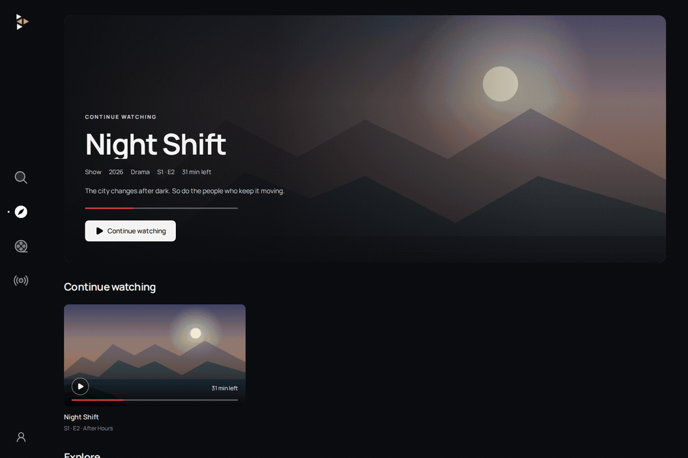

# Restream

Restream brings your IPTV subscription to the browser. Host it on your own computer or server to watch live TV, movies, and shows from a Stalker/MAG provider, with a programme guide, search, watch progress, and a shared library cache. Use it on desktop or mobile, with optional OIDC sign-in through your own identity provider.

[](docs/assets/showcase.png)

*Home, your library, and playback in one place. The preview uses a fictional demo library; select the image for a still view.*

## Features

- 📺 **Live TV and programme guide**: browse channels and see what's on now and next.
- 🎬 **Movies and shows**: explore searchable categories or search across your whole library.
- ▶️ **Pick up where you left off**: Continue watching, Up next, and Recently played, with history and progress saved on your server and shared across devices for each signed-in account. Without sign-in, everyone shares one history.
- 🧭 **Discovery**: browse Explore and optional TMDB Trending side by side on Home, matched to titles your provider carries.
- ⚡ **Shared library cache**: cached listings stay available while the server refreshes them in the background, reducing repeated requests to your provider.
- 🔐 **Optional OIDC sign-in**: use your identity provider with viewer and administrator roles, or run without a login on your private network.
- 📱 **Desktop and mobile**: responsive browsing, touch controls, and fullscreen playback.
- 💬 **Subtitles**: choose provider subtitles or embedded captions from the player's CC menu. Preview your preferred font, size, color, and background in Settings, saved for this browser. Availability varies by movie and episode.

## Get started

You'll need Docker and a Stalker/MAG IPTV subscription, including your provider's portal URL and registered MAC address. The Docker image includes everything needed to run Restream.

```sh
docker run -d \
  --name restream \
  --restart unless-stopped \
  --stop-timeout 20 \
  -p 8080:8080 \
  -v restream-data:/data \
  ghcr.io/pushpinderbal/restream:latest
```

Open [http://localhost:8080](http://localhost:8080), or `http://<server-address>:8080` from another device on your network. Choose **Account → Settings**, enter your provider's portal URL and MAC address, and select **Save changes**. If your provider requires a serial number or device IDs, add them under **Device identity**.

### Docker Compose

From a clone of this repository, use the included [Compose file](compose.yaml):

```sh
docker compose up -d
```

Connect your provider in **Account → Settings** as above. No environment file is required.

## Configuration

Restream supports configuration through the UI and environment variables. Environment variables override corresponding saved settings and make those fields read-only in **Account → Settings**.

See [.env.example](.env.example) for the full list and required values. Copy and adapt it to `.env` for Compose or Docker's `--env-file .env`, or set the variables directly in your environment.

## Local development

Install [mise](https://mise.jdx.dev/getting-started.html), then run:

```sh
mise install
mise run dev
```

Open [http://localhost:5173](http://localhost:5173) and connect your provider in Settings. Go and UI changes reload automatically; press Ctrl+C to stop.

Run `mise run test` for Go tests, `mise run test:browser` for browser workflows, or `mise run test:container` to check the packaged app using temporary containers and storage.

## License

MIT. See [LICENSE](LICENSE).
